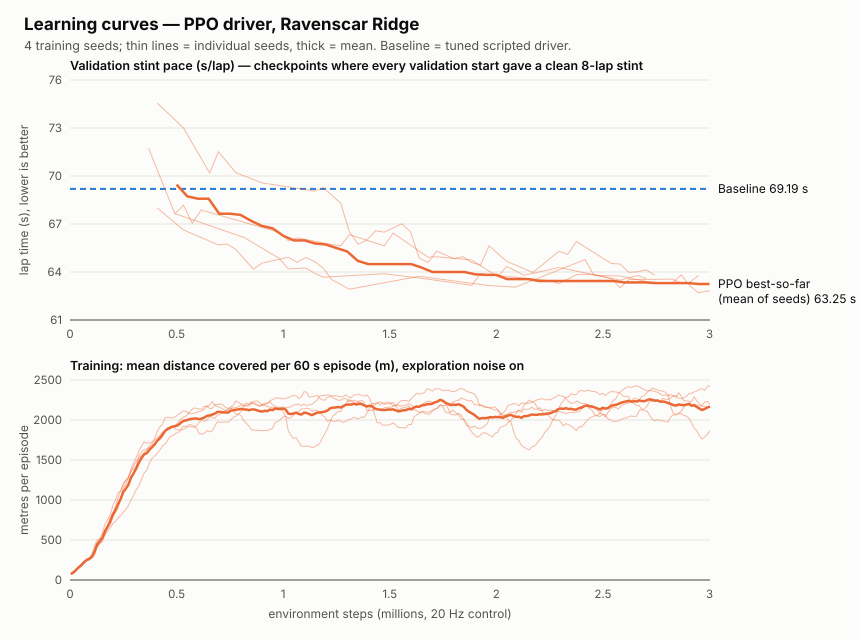

# Racing Simulator

A browser racing simulator with a deterministic vehicle-dynamics core, sixteen
cars from different classes (a six-car GT3 field: 911-style Arrow GT3-R, Audi R8 LMS,
Lamborghini Huracán, Mercedes-AMG GT3, Ferrari 296 and McLaren 720S; Ferrari 458,
Lamborghini Huracán LP 610-4 and Aventador SVJ road cars, Le Mans hypercar, Audi R18 LMP1, stock Mini
Cooper S, hot hatch, muscle coupe, V10 single-seater, electric saloon), seven
circuits (one original; Silverstone, Spa, Monza, the Nürburgring Nordschleife,
Monaco and Laguna Seca from real survey / map data, with gravel beds and barrier lines
from OpenStreetMap), engine audio played from real
recordings, an interactive telemetry overlay, AI drivers that follow a computed
racing line and trail-brake — and an AI driver trained with reinforcement
learning on the same physics code the browser runs.

```bash
npm install
npm run dev        # http://127.0.0.1:5173
npm test           # physics, determinism, car envelopes, tracks, audio, wet-track model
npm run validate   # measure every car against real-world figures
npm run train -- --car gt3 --seed 1 --steps 3000000
npm run benchmark  # fixed-seed RL vs baseline, writes docs/benchmark-gt3.json
npm run plot       # docs/learning-curve-gt3.svg, docs/benchmark-gt3.svg
```

Controls: **WASD / arrows** drive (gamepad supported) · **Q / E** shift ·
**M** auto/manual · **R** recover · **Enter** restart · **C** camera (chase → far → bonnet → cockpit → TV) ·
**T** telemetry · **G** ghost (best / AI) · **I** AI autopilot · **Z** ABS ·
**X** TC · **H** driving difficulty · **L** racing-line guide · **V** weather · **F** perf stats · **N** mute ·
**1–9, 0** first ten cars · **[ ]** previous / next car (all sixteen) · **Esc** menu.

**Phones and tablets:** on a touch screen the game shows on-screen controls: brake and
throttle pedals on the right, and either **left / right buttons** or **tilt steering** (hold
the phone like a wheel; the angle is taken from gravity so it needs no calibration), switched
with the Tilt / Buttons button at the top, next to Cam, Reset, Assist and Menu. Tilt needs the
browser's motion-sensor permission (iOS asks on first use) and is not available inside some
embedded frames; the game falls back to buttons if no sensor data arrives. Tested with emulated
touch input only, not on a physical phone.

**Driving difficulty** (menu or **H**; affects only the human driver, never the AI, tests or RL):
*Simulation* is the car as specified. *Assisted* adds ABS, traction and stability control to
every car and 8 % grip. *Easy* is deliberately unrealistic and meant for keyboards: 30 % more
grip, the car steers itself along the racing line when no steering key is held (a held key adds
to it), and it brakes for corners by itself. Measured: with the throttle simply held down and
no other input, Easy laps Ravenscar, Silverstone, Spa, Monza and Monaco cleanly in the GT3,
Mini, formula car and hypercar, and completes a Nordschleife lap in three of the four (the
Mini ran out of test time).

## Architecture

```
src/sim/      deterministic core, no DOM — shared by browser, tests and RL
  track.js      circuits -> typed arrays (centreline, width, curvature, elevation, walls)
  vehicle.js    vehicle dynamics (300 Hz fixed step)
  cars.js       sixteen car specifications + real-world reference envelopes
  racing-line.js minimum-curvature racing line for any circuit
  sim.js        car + track + lap/sector timing + track limits
  drivers/      line-following driver, RL observation/action interface, policy runner
src/game/     Three.js renderer, cameras, HUD, telemetry, effects, cannon-es props
src/audio/    AudioWorklet engine: recorded engine cycles + synthesised tyres, wind, turbo
rl/           environment, PPO, training, benchmark, plots
tools/        car validation, lap/line tools, audio and car-model build pipelines, screenshots
tests/        node:test suites
```

**Physics library choice.** Three.js renders; cannon-es simulates the loose
trackside objects (cones, braking boards) that the car knocks around. The car
itself is *not* a rigid-body-engine vehicle: generic raycast vehicles don't
give believable tyre behaviour and aren't bit-reproducible, and the RL work
needs both. The vehicle model is purpose-written and runs identically in Node
and the browser (same seed + same inputs = identical state, tested).

### Vehicle model
3-DOF planar chassis plus four wheel-spin states at 300 Hz:

- **Tyres** — combined-slip Magic Formula on a normalised slip vector, load
  sensitivity of peak grip, cornering stiffness that grows sub-linearly with
  load, surface-dependent grip (asphalt / kerb / grass / gravel), and a thermal
  state that costs grip when cold or overheated.
- **Load transfer** — lagged longitudinal and lateral transfer with a per-car
  roll-stiffness split, plus speed-squared downforce with an aero balance.
- **Drivetrain** — engine torque curves, turbo spool, rev limiter, clutch slip
  on launch, gear ratios with shift torque-cut, limited-slip differential,
  FWD / RWD / AWD, lift-off regen on the EV.
- **Aids** — ABS with rear-axle EBD and a model-based traction-control torque
  limiter, only on cars whose real counterparts have them (toggle with Z / X).
- **Environment** — road gradient, track limits, walls.

Not modelled: suspension geometry/kinematics, vertical dynamics over crests,
tyre wear, fuel load, car-to-car contact.

### Cars — measured, not asserted
`npm run validate` runs each car through standard tests on a flat pad and
checks the result against a published range for that class of car:

| car | hp | kg | 0-100 s | 100-0 m | lat g (R60) | top km/h |
|---|---|---|---|---|---|---|
| Arrow GT3-R | 531 | 1320 | 2.93 [2.9,3.6] ok | 24.2 [22,29] ok | 1.54 [1.45,1.75] ok | 283 [270,295] ok |
| Audi R8 LMS GT3 | 535 | 1315 | 2.91 [2.9,3.6] ok | 24.1 [22,29] ok | 1.56 [1.45,1.75] ok | 289 [270,295] ok |
| Lamborghini Huracán GT3 | 536 | 1310 | 2.98 [2.9,3.6] ok | 24.2 [22,29] ok | 1.59 [1.45,1.75] ok | 291 [270,295] ok |
| Mercedes-AMG GT3 | 542 | 1345 | 3.44 [2.9,3.6] ok | 24.4 [22,29] ok | 1.59 [1.45,1.75] ok | 286 [270,295] ok |
| Ferrari 296 GT3 | 525 | 1325 | 2.99 [2.9,3.6] ok | 24.1 [22,29] ok | 1.58 [1.45,1.75] ok | 290 [270,295] ok |
| McLaren 720S GT3 | 521 | 1315 | 2.90 [2.9,3.6] ok | 24.1 [22,29] ok | 1.57 [1.45,1.75] ok | 288 [270,295] ok |
| Ferrari 458 Italia | 562 | 1565 | 3.40 [3.2,3.7] ok | 31.8 [30,35] ok | 1.07 [1,1.15] ok | 335 [315,335] ok |
| Lamborghini Huracán LP 610-4 | 602 | 1630 | 2.94 [2.9,3.4] ok | 31.7 [30,35] ok | 1.06 [1,1.15] ok | 326 [315,332] ok |
| Lamborghini Aventador SVJ | 759 | 1775 | 2.88 [2.6,3.1] ok | 30.1 [29,34] ok | 1.13 [1.08,1.28] ok | 351 [340,362] ok |
| Aurelia LMH | 671 | 1110 | 2.53 [2.4,3.1] ok | 22.0 [17,23] ok | 2.01 [1.9,2.8] ok | 329 [325,350] ok |
| Audi R18 e-tron quattro | 503 | 1000 | 2.72 [2.6,3.4] ok | 21.7 [17,23] ok | 1.97 [1.9,2.8] ok | 318 [315,340] ok |
| Mini Cooper S | 189 | 1310 | 7.22 [6.4,7.3] ok | 35.9 [33,38] ok | 0.90 [0.88,1.02] ok | 237 [225,240] ok |
| Vanta RS | 315 | 1455 | 5.50 [5,6] ok | 31.8 [31,37] ok | 1.09 [0.98,1.12] ok | 273 [262,282] ok |
| Brawler GT 5.0 | 480 | 1795 | 4.70 [4.2,5] ok | 32.5 [31.5,37] ok | 0.98 [0.93,1.05] ok | 300 [270,300] ok |
| FX-10 | 883 | 655 | 2.34 [2.2,2.9] ok | 20.6 [15,21] ok | 2.35 [2.3,3.2] ok | 333 [320,350] ok |
| Volt-R Quad | 766 | 2330 | 3.14 [2.6,3.2] ok | 32.0 [31,37] ok | 1.07 [0.95,1.1] ok | 269 [250,270] ok |

Format: measured `[reference range]`. The muscle coupe's top speed is unrestricted (the real car is limited to 250 km/h).

The Aurelia LMH is a 499P-class Le Mans Hypercar (twin-turbo V6, ~680 hp,
1110 kg, high downforce, no ABS); the Mini is a stock F56 Cooper S (2.0 turbo, FWD,
road tyres). The Audi R18 e-tron quattro is the 2012 LMP1 (3.7 V6 turbodiesel,
~500 hp, rear-drive only here: its front hybrid axle is not modelled). Flying-lap times of the in-game AI (racing-line driver, shipped
tuning, all laps inside track limits; `node tools/ai-laps.js`):

| car | Ravenscar | Silverstone | Spa | Monza | Nordschleife | Monaco | Laguna Seca |
|---|---|---|---|---|---|---|---|
| FX-10 | 0:53.54 | 1:58.43 | 2:08.89 | 1:37.50 | 5:48.99 | 1:34.06 | 1:19.12 |
| Aurelia LMH | 0:56.23 | 2:02.39 | 2:15.12 | 1:44.00 | 6:31.81 | 1:40.28 | 1:22.23 |
| Audi R18 | 0:57.86 | 2:06.56 | 2:19.81 | 1:48.16 | 6:45.21 | 1:42.43 | 1:24.74 |
| Arrow GT3-R | 1:04.49 | 2:19.78 | 2:34.72 | 1:57.35 | 7:27.40 | 1:46.86 | 1:32.31 |
| Audi R8 LMS GT3 | 1:04.17 | 2:19.13 | 2:33.90 | 1:56.68 | 7:25.08 | 1:46.46 | 1:31.86 |
| Lamborghini Huracán GT3 | 1:04.39 | 2:19.07 | 2:33.60 | 1:56.39 | 7:24.81 | 1:46.34 | 1:31.78 |
| Mercedes-AMG GT3 | 1:04.82 | 2:19.21 | 2:34.20 | 1:57.19 | 7:25.88 | 1:46.74 | 1:32.16 |
| Ferrari 296 GT3 | 1:04.22 | 2:18.97 | 2:33.45 | 1:56.34 | 7:24.67 | 1:46.35 | 1:31.70 |
| McLaren 720S GT3 | 1:04.20 | 2:19.05 | 2:33.62 | 1:56.34 | 7:24.95 | 1:46.36 | 1:31.74 |
| Ferrari 458 | 1:15.95 | 2:43.17 | 2:59.25 | 2:11.66 | 8:47.33 | 2:03.33 | 1:47.16 |
| Huracán LP 610-4 | 1:16.77 | 2:45.89 | 3:01.66 | 2:12.87 | 8:48.53 | 2:02.08 | 1:48.51 |
| Aventador SVJ | 1:17.14 | 2:45.75 | 3:01.16 | 2:11.15 | 8:26.76 | 1:57.80 | 1:48.73 |
| Volt-R | 1:19.09 | 2:49.31 | 3:05.56 | 2:14.40 | 8:44.47 | 2:01.23 | 1:51.02 |
| Vanta RS | 1:20.83 | 2:52.81 | 3:12.05 | 2:23.80 | 9:30.21 | 2:11.05 | 1:53.98 |
| Brawler GT | 1:21.50 | 2:54.68 | 3:12.89 | 2:22.82 | 9:33.68 | 2:11.58 | 1:54.99 |
| Mini Cooper S | 1:28.97 | 3:07.43 | 3:30.05 | 2:38.72 | 10:28.12 | 2:22.95 | 2:04.50 |

**GT3 class.** The five real GT3 cars added in 0.9.0 are specified from published homologation
figures (wheelbase, dimensions, engine type and rev range, homologated weight) at typical
balance-of-performance power, and share one class envelope with the Arrow GT3-R. They differ where
the real cars do: the R8 and Huracán share the 5.2 V10 (peaky, 8,500 rpm) but the Lamborghini has more front
aero, less front roll stiffness and a looser differential; the front-mid-engined AMG carries 49.5 % of its
weight on the nose, has the highest yaw inertia and the most drag, and 650 Nm from 3,500 rpm to a
7,300 rpm redline; the turbo Ferrari and McLaren have a boost-limited torque plateau, the lowest
centres of gravity and the least drag. Track widths, CG heights and aero coefficients are estimates.
With the same AI driver settings the six cars cover 1.0 % at Ravenscar (1:04.17–1:04.82)
and 0.9 % at Spa (2:33.33–2:34.69), every new car within 1 % of the Arrow GT3-R; in rain the five new cars lap Spa in 3:01.4–3:01.9 and Ravenscar in 1:17.2–1:17.4, all inside track limits
(`node tools/wet-laps.js ravenscar,spa r8lms,huracan,amggt3,f296gt3,mc720s rain`).

**Road Lamborghinis.** The Huracán LP 610-4 (610 PS V10, AWD, dual-clutch) and Aventador SVJ (770 PS V12, AWD,
single-clutch ISR gearbox with a 90 ms torque gap, ALA modelled as fixed moderate downforce) are specified from
Lamborghini's published figures and checked against them: 0–100 km/h 3.2 s / 2.8 s claimed, 2.94 / 2.88 s measured
(the SVJ is traction-limited here); top speed 325 / >350 km/h claimed, 326 / 351 measured. The AI drives the SVJ with a
cautious setting (it was the only car to spin on its out-lap at a wet Spa with a normal one), so its AI laps on short
circuits are no quicker than the 458's; that is the driver, not the car.

The class order is what it should be everywhere. Absolute pace on the real
circuits is 10-15 % off real-world lap records for the class (e.g. GT3 at Spa:
2:34.9 here, about 2:17 in reality): the driver keeps a safety margin and the
model has no suspension, so kerb-riding and crest behaviour are missing.

### Circuits
| Circuit | Length | Layout source | Elevation |
|---|---|---|---|
| Ravenscar Ridge | 2.91 km | Original design: 10 turns, hairpin, esses, flat-out kink | designed, 23 m relief |
| Silverstone GP | 5.89 km | Surveyed centreline + widths (TUMFTM racetrack-database, LGPL-3.0) | hand-approximated (nearly flat) |
| Spa-Francorchamps | 7.00 km | same | EU-DEM 25 m terrain model: 105 m relief, max 13 % (Raidillon), under 10 % elsewhere |
| Monza | 5.79 km | same | EU-DEM 25 m: 13 m relief, max 1.8 % |
| Nürburgring Nordschleife | 20.75 km | OpenStreetMap centreline (ODbL) | EU-DEM 25 m: 288 m relief, max 15.6 % up, 11 % down |
| Monaco | 3.31 km | OpenStreetMap street centrelines (ODbL), official 3.337 km | SRTM 30 m, scaled to the real 42 m relief (rooftops inflate it), max 7.3 %; the tunnel stretch is bridged |
| Laguna Seca | 3.60 km | OpenStreetMap raceway centreline (ODbL), official 3.602 km, anticlockwise | USGS 3DEP 10 m (`ned10m`), 57 m relief; the Corkscrew drops 17.5 m in 140 m (peak gradient 16 %), under 14 % elsewhere |

What "real" means here, precisely: the **plan-view layout is real survey or
map data** (lap lengths within 1 % of official figures — tested), and elevation
on five of the six real circuits is sampled from public terrain models and
smoothed. Track width is surveyed for the TUMFTM circuits and estimated for
the Nordschleife, Monaco and Laguna Seca. Buildings and scenery are generated,
themed per circuit (forest at the Nordschleife, apartment blocks at Monaco, dry
golden hills with scattered oaks at Laguna Seca) but not replicas: no Monaco
landmarks, no Eau Rouge grandstands. Monaco's surroundings are OpenStreetMap building
footprints extruded to their tagged heights, the real harbour outline with moored yachts and an
enclosed tunnel (`tools/monaco-scene.mjs` → `monaco.scene.json`).

#### Elevation: a fitted profile, not a clipped one
A 10–30 m terrain model sampled along a road is the road plus noise: grid steps, the hillside the
road is cut into, tree canopy, rooftops, bridges. `fitElevation` in `src/sim/track.js` therefore fits a
**periodic smoothing spline** to the samples (exactly a 4th-order low-pass on a closed lap; cutoff
wavelength per circuit: 110 m for the 10 m model at Laguna Seca, 200 m for EU-DEM at Spa and the
Nordschleife, 350 m for SRTM in Monaco, 600 m at Monza), made robust by pulling samples more than 2.5 m
off the fit back to it, with tunnel stretches bridged. Where the fit still exceeds the circuit's
realistic gradient (or a vertical curvature no racing surface has) only that stretch is refitted with
a longer cutoff — nothing is clipped — and Monaco and Monza are scaled to their published relief.

| Circuit | Relief before → after | Max gradient | RMS gradient | Crests + dips per km |
|---|---|---|---|---|
| Spa | 106.0 → 105.4 m | 19.8 → 13.1 % (was a false −19.8 % after Bruxelles) | 6.21 → 5.64 % | 3.1 → 2.6 |
| Monza | 17.4 → 13.0 m | 5.0 → 1.8 % | 1.64 → 0.76 % | 4.1 → 1.7 |
| Nordschleife | 288.2 → 287.5 m | 19.9 → 15.6 % up, 11.0 % down | 6.54 → 6.10 % | 3.1 → 2.5 |
| Monaco | 49.3 → 42.0 m | 11.4 → 7.3 % | 4.33 → 3.45 % | 3.6 → 2.4 |
| Laguna Seca | 57.2 → 57.4 m | 16.3 → 16.1 % (Corkscrew only; 13.3 % elsewhere) | 6.05 → 6.18 % | 4.4 → 5.0 |

Ravenscar (analytic) and Silverstone (hand profile, 11 m) are unchanged. Still wrong: Raidillon peaks at
13 % against a real 17–18 % (the 25 m model cannot resolve it and the fit will not invent it), Beau
Rivage at 6 % against about 10 %, and nothing here is a survey. The landscape around flat circuits is
now flat too (it used to get 60–130 m hills regardless); there is no vertical exaggeration, camber or
banking in the renderer.

#### Trackside: kerbs, run-off, gravel, barriers
What lies beside the road is data per circuit, per corner and per side
(`src/sim/trackside.js`), used by the physics and the renderer alike. It comes
from two sources that the data keeps apart:

- **Surveyed from OpenStreetMap** (`trackside.osm` inside each circuit's JSON,
  produced by `tools/trackside-osm.mjs`): gravel / sand polygons and barrier
  ways, ray-cast from the centreline every 4 m. The TUMFTM circuits are in
  local metres with an unknown origin, so the tool first fits a rotation and
  translation against OSM's `highway=raceway` geometry (ICP) and stores the
  residual. OSM polygons are traced from aerial imagery of unknown date.
- **Hand-authored from memory** (`src/sim/tracks/<id>.trackside.json`, every
  entry tagged `src: memory`): which corners have paved run-off, kerb colours
  and types, astro-turf and painted strips, sausage kerbs, escape roads, pit
  walls. These are *not surveyed* and some are certainly wrong in detail.
- Kerb *placement* is rule-made everywhere (apex kerb on the inside, exit kerb
  on the outside), not copied from the venue.

| Circuit | From OSM | Hand-authored (memory) | Not modelled |
|---|---|---|---|
| Silverstone | 29 gravel beds, barrier lines over 88 % of the lap (fit: 2.0 m mean residual, 94 % of samples within 6 m) | paved run-off in front of the gravel at 13 corners, astro-turf behind six exit kerbs, blue/white kerbs at Village and The Loop (colour is a guess), pit wall | painted run-off graphics, real kerb positions |
| Spa | 13 gravel beds (the 2022 layout with gravel back at Les Combes, Bruxelles, Pouhon, Fagnes, Stavelot, Blanchimont), barriers over 98 % (fit 1.6 m) | paved run-off at La Source, Eau Rouge / Raidillon, Les Combes, Bus Stop; red/yellow kerbs; yellow sausage kerbs and serrated kerbs at the Bus Stop; TecPro at the escape areas | endurance pit lane, Raidillon's exact new run-off shape |
| Monza | 11 gravel beds (Curva Grande, Roggia exit, both Lesmos, Ascari, behind the Parabolica asphalt), barriers on 44 % of the lap (fit 1.4 m) | paved escape areas at the Rettifilo and Roggia with TecPro, sausage and serrated kerbs at both chicanes, paved strip in front of the Parabolica gravel, pit wall | polystyrene boards / escape-road slalom, the old banking |
| Nordschleife | barrier lines for 97 % of the lap (clamped to 3.2–30 m from the road edge), 7 gravel beds (Hatzenbach entry, Aremberg, Brünnchen, Pflanzgarten, GP link), section names | small gravel beds at Adenauer Forst and Bergwerk | the Karussell's concrete banking; kerbs still stand on both sides of every corner (the AI tuning depends on that layout) |
| Monaco | centreline; 686 building footprints (357 with tagged height, the rest guessed from area), the coastline / quays of Port Hercule, the tunnel's station range (1,542–1,904 m) | barriers at the kerb everywhere; three escape roads as short paved spurs (Sainte Dévote, Mirabeau, Nouvelle Chicane) closed by TecPro; sausage kerbs at the chicane and the swimming pool | real street widths (uniform 9.4 m), the Rascasse and Noghès escape pockets; façades, yachts and the tunnel interior are generic (procedural windows, box hulls, a plain box section); no palm trees, grandstands, pit building or Casino / Piscine landmarks |
| Laguna Seca | centreline, barrier lines for 97 % of the lap, the Corkscrew gravel | gravel at Turns 2, 3, 4, 5, 6, 9, 10 and 11 (which corners have it; depth follows the surveyed barrier), serrated Corkscrew kerbs, two footbridges (positions approximate) | widths per section are estimates |
| Ravenscar (fictional) | — | designed: paved run-off with a gravel band at Anvil, Crow's Nest and Home, gravel wedges elsewhere, pit wall. Kerbs and the first 2 m of verge are untouched so the RL benchmark is bit-identical | — |

Surface physics (`SX_MU`, `SX_ROLL` in `src/sim/trackside.js`; grip is a
fraction of the tyre's own friction, rolling resistance a fraction of wheel load):

| Surface | Grip | Rolling resistance | Wet (extra factor) | Notes |
|---|---|---|---|---|
| asphalt | 1.00 | 0.013 | — | unchanged |
| flat painted kerb | 0.93 | 0.016 | — | unchanged; counts as track |
| serrated rumble kerb | 0.90 | 0.024 | 0.95 | counts as track; the racing line uses 0.3 m of it instead of 0.5 m; full `rumble` signal |
| sausage kerb | 0.50 | 0.12 | 0.90 | 0.55 m hump behind the kerb, off track: drags and yaws the car |
| paved run-off | 0.95 | 0.015 | 0.97 | dusty, off the rubbered line; lap still invalid (four wheels over the edge) |
| painted run-off / green paint | 0.86 | 0.015 | 0.80 | |
| astro-turf | 0.62 | 0.035 | 0.82 | |
| grass | 0.45 | 0.07 | per weather | unchanged |
| gravel | 0.42 | 0.17 + 0.09 × depth + 0.30 × speed | per weather | depth saturates 6 m into the bed, speed at 90 km/h: 0.56 when ploughing in deep at speed (a GT3 coasting at 162 km/h loses about 8 m/s² against 3 m/s² on grass), 0.17–0.26 when crawling out, which a rear-driven car only just manages |
| Monaco paving | 0.80 | 0.02 | 0.92 | was treated as grass before |

`car.surfX[i]` holds the detailed surface under each wheel (`car.surf[i]` still
the four original classes) and `car.rumble` (0–1) is a vibration signal for
audio and camera; the audio's kerb layer uses the kerb type. Barriers are
armco, concrete walls, TecPro blocks or conveyor-belted tyre walls per corner
(`track.barL/R`); they differ in looks only — every barrier is the same rigid
wall to the physics. `node tools/trackside-map.mjs <track> out.png [s0 s1]`
draws the trackside exactly as the physics sees it, and
`tools/trackside-shot.mjs` takes screenshots with a free camera.

### AI racing line
`src/sim/racing-line.js` computes a minimum-curvature line inside the track
limits for every circuit (projected Gauss-Seidel, coarse to fine). The AI
driver follows it with pure pursuit and a curvature-limited speed profile, and
**trail-brakes**: brake pressure is released as lateral load builds, by a
per-car fraction. Measured with `tools/trail.js` on Ravenscar in the GT3: the
line driver spends 42 % of its braking time above 70 % of cornering grip
(centre-line driver 8 %, RL policy 60 %). Press **L** in the game to draw the
line on the road, coloured by throttle (green), coast (amber) and brake (red).

### Rendering
Three.js r187 with image-based lighting from a photographed HDR sky (Poly
Haven), scanned PBR asphalt, grass, gravel and concrete (Poly Haven,
ambientCG), rubbered-in racing line, AgX tone mapping, GTAO, bloom and SMAA on
high quality. Eleven of the sixteen cars use detailed third-party glTF models
(Draco-compressed, wheels cut out and re-rigged offline by
`tools/models-build.mjs`); every asset, author and licence is listed in
[ASSETS.md](ASSETS.md).

### In-car cameras
**C** cycles chase, far, bonnet, cockpit and trackside TV. The two in-car views need no per-car
tuning (`src/game/cockpit*.js`): the body, whether a glTF model or a code-generated shell, is
rasterised once into a 2.5 cm height map, and the roof, windscreen header and base, belt line and
glasshouse width are read off it. From those come the **eye point** (left seat; the Mini is
right-hand drive; offset-centre in the prototypes, central in the single-seater; a fixed distance
behind the header but kept within the part of the wheelbase where a driver sits, about 20 cm under
the roof skin, never less than 12 cm above the scuttle), the **bonnet camera** (centreline, 15 cm
above everything around the base of the screen; a nose camera on the formula car) and a convex
*cabin hull*. A **procedural cockpit** is built on the same measurements and shown only in the
driver's-eye view: dashboard, instrument cluster drawn live to one canvas texture at 20 Hz (dials
in road cars; rev bar, gear, speed, lap time and ABS / TC lamps on a race logger; on the wheel
itself in the prototypes and the formula car), steering column and wheel (round with an airbag
hub, or a flat butterfly wheel with buttons, rotaries, paddles and shift LEDs), gloved hands at
nine and three with two-bone IK arms, A-pillars, header, mirror, roof lining and door tops, a
roll cage and window net in GT cars, and a gear lever the inboard hand reaches for in the
manual cars. While you are inside, everything the exterior model has within the hull (its own
static interior and steering wheel, opaque or tinted glass, the roof) is clipped away per
fragment, so no model shows a second wheel, and what you see through the openings is the real
model: bonnet, wings and door mirrors. The wheel turns the road-wheel angle times a steering ratio
(14:1 road, 11:1 GT, 9:1 prototype, 7:1 formula), eased towards about 115–125° so the hands can
stay on the rim; the camera rides on the sprung body (the cabin stays put, the horizon pitches and
rolls), looks a little into the corner and moves a couple of centimetres with the g-forces.
Per-car exceptions go in `spec.cockpit` (`side`, `eye` nudge, any ergonomic field); see
`tools/cockpit-shots.mjs` for the check that photographs every car.

### Weather and time of day
Six conditions, chosen in the menu, with **V** while driving, or by URL
(`?wx=clear|golden|overcast|rain|storm|dusk`, alongside `?track=`, `?car=`,
`?q=`): clear day (the photographed sky), golden hour, overcast with a damp
track, rain, a storm at low sun, and dusk with lights on. They switch in place.

- **One description drives everything** (`src/game/wx.js`): the sky, the sun
  light, the environment map, the fog and its glow toward the sun are all
  built from the same numbers, so they cannot disagree. Skies other than the
  clear day are generated (`src/game/skygen.js`): fbm cloud decks with
  self-shadowing and a sun gap, baked once per condition into an HDR panorama
  that is also prefiltered (PMREM) for image-based lighting. Low suns sit ahead
  of the grid on every circuit.
- **Wet surfaces** (`src/game/world.js`): asphalt darkens and turns glossy
  under a water film, standing water gathers along the edges and in low spots
  with rain rings, the rubbered line dries first on the damp track; kerbs,
  paint, grass, gravel, paving and barriers respond too. The car and its lamps
  are mirrored in the road (a second, car-only render from the reflected
  camera; medium and high quality).
- **Rain, spray, light** (`src/game/weather.js`): streaks drawn along each
  drop's motion relative to the camera, so they slant and stretch with speed;
  wheel spray that grows with speed; screen-space light shafts from the open
  sky, water beads on the lens, lightning that relights the scene (thunder
  follows after the distance delay); headlights, brake and rain-light glows,
  and floodlights along the start straight at dusk.
- **Physics** (`src/sim/wet.js`): a wet state scales tyre grip — rain 0.77 and
  storm 0.72 of dry on asphalt, less in the standing water at the edges (up to
  -14 % / -20 %), on painted kerbs and on grass; the damp track is 0.88 off
  line but nearly dry on it. `null` (the default) leaves the simulation
  bit-identical, which the tests check. The racing-line driver scales its
  speed profile and feeds the power in more gently (`tools/wet-laps.js`
  measures it): GT3 at Spa 2:34.87 dry, 3:02.65 rain, 3:09.45 storm.
- **Quality tiers**: low draws a quarter of the rain, no mirror and no lens
  pass; medium adds a short post chain only when the weather needs it; high
  keeps its full chain.

### Audio
Every combustion car's engine is **played from a real recording** of that
engine type (Wikimedia Commons, CC BY / CC BY-SA; sources and authors in
[AUDIO.md](AUDIO.md)). The recordings are rev blips and pull-aways rather than
steady loops, so `tools/audio-build.py` tracks the firing frequency, cuts each
recording into single 720° engine cycles, sorts them by rpm and by on/off
load, and the AudioWorklet replays cycles at the simulated crank phase: pitch
follows rpm exactly, and a different real cycle each revolution keeps the
natural roughness.

| Car | Recording used | Bands with real cycles (rpm) |
|---|---|---|
| Arrow GT3-R | Porsche 911 GT3 (991), flat-six | 1300–9200, all |
| Audi R8 LMS GT3 | Audi R8 LMS GT3 (2010) pulling away + road R8 5.2 V10 | 2130–3600; rest pitch-shifted |
| Lamborghini Huracán GT3 | Huracán Performante 5.2 V10, straight pipes | 1500–3600; rest pitch-shifted |
| Mercedes-AMG GT3 | SLS AMG 6.2 V8 (one band) + Ford Mustang GT 5.0 | 4870 Mercedes; 1100–3940, 6020, 7450 Mustang |
| Ferrari 296 GT3 | shares the Aurelia LMH bank (Ferrari 296, the same V6) | 3030–4290 and 6075 only |
| McLaren 720S GT3 | McLaren 720S 4.0 twin-turbo V8 | 1810–8100, nearly all |
| Ferrari 458 | 458 Speciale + 458 Italia | 740, 1840–9100 |
| Huracán LP 610-4 | shares the Huracán GT3 bank (Huracán Performante, the same V10) | 1500–3600; rest pitch-shifted |
| Aventador SVJ | none usable — synthesised even-firing V12 (see AUDIO.md) | — |
| Brawler GT | Ford Mustang GT 5.0 + Mach 1 | 925–4000, 6080, 7500 |
| Vanta RS | Honda Civic Type R | 1300, 2460–7100 |
| Mini Cooper S | Mini Countryman / Clubman (same 2.0 turbo family) | 800–6600, all |
| Aurelia LMH | Ferrari 296 (120° twin-turbo V6) + Nissan GT-R | 3030–4290 and 6075 only; rest pitch-shifted |
| FX-10 | F1 V10s (Red Bull RB1 2005, STR1 2006) + Porsche Carrera GT below ~9000 | 14,300 and 16,500; 4000 and 4600 |
| Volt-R | none found — synthesised motor and inverter whine | — |
| Audi R18 | none found (no open turbodiesel race recording) — synthesised | — |

Measured against the source recordings at matched rpm (log-spectral distance,
1/6-octave bands): the previous pure synthesiser was 11–16 dB away and almost
perfectly periodic; the recorded-cycle engine is 2.6–6.4 dB away with
real cycle-to-cycle variation, and about 8 dB from *different* cars of the same
engine type (roughly the car-to-car spread). Turbo whistle and blow-off, gear
whine, overrun pops, tyre squeal and scrub, wind, kerbs, grass and gravel are
synthesised layers; exterior, bonnet and trackside (Doppler) cameras have
separate mixes. **Nobody has listened to this**: this environment has no audio
output, so everything was tuned by spectra and level meters. AUDIO.md lists
what to listen for first and the known weak spots.

## Race mode

Wheel-to-wheel racing against a field of AI cars: **Race** in the menu (2–20 cars, laps, your grid slot,
opponents of the same car / same class / mixed classes, five AI levels) or by URL, e.g.
`?race=12&laps=5&grid=6&field=class&aiskill=0.95&track=spa&car=gt3` (`&ai` puts an AI in your car as well, so a
whole race can be watched or run headless; `&seed=`, `&order=quali|reverse|random`, `&cam=`, `&follow=`,
`&director`, `&tags=0`). The hot-lap mode is unchanged and a solo `Sim` is bit-for-bit what it was (hash test).

**Simulation** (`src/sim/race.js`, DOM-free, deterministic, 300 Hz). A `Race` is N solo `Sim`s stepped in a
fixed order, plus three stages the solo car never sees:

- *Contact.* Body rectangles (`spec.body` length × width), bounding-circle broad phase, separating-axis
  narrow phase, one impulse per pair and step with restitution 0.18 and Coulomb friction 0.35 applied at the
  contact point, so an off-centre hit yaws both cars, then a positional push-out split by inverse mass.
  Tests: linear and angular momentum conserved to 1e-9, kinetic energy never rises in the impulse stage, no
  tunnelling at 300 km/h closing speed, bodies never stay overlapped for more than 10 steps.
- *Slipstream.* `Vehicle.dragK` / `downK` (exactly 1 in free air): up to −40 % drag and −12 % downforce
  directly behind another car, falling with distance (90 m) and sideways offset.
- *Race logic.* Staggered two-wide grid behind the line, five red lights then a seeded random hold, per-driver
  reaction times, positions by race distance, gaps and intervals from 25 m time stamps, sector / lap / best
  lap per car (the solo lap timer), blue flags, finish when the leader completes the distance (everyone else
  finishes the lap they are on), classification, marshals who put a spun or stuck car back on the road off
  the racing line when no one is about to arrive (four times, then DNF), and track limits: every third
  four-wheels-off excursion not caused by a contact costs 5 s.

**Racecraft** (`src/sim/drivers/racecraft.js`). `RaceDriver` wraps the tuned racing-line `BaselineDriver`: in
free air it *is* that driver, bit for bit (test). Thirty times a second it decides which path and which
speed to feed it:

- *Path* = racing line + a lateral offset, in a lane that leaves a car's width to anyone alongside (their
  path is predicted as the line's shape at their present offset, clamped to the road). The offset moves at a
  human rate on the straights and is held through corners. Speed profiles are precomputed for the line
  shifted by ±1.5, ±3 and ±6 m (clamped to the road), with less grip off line (and the wet model's drying
  line), so a car that is off line brakes for the corner it will actually drive.
- *Following.* Match the car ahead's pace as a fraction of what I could do *where it is* (so I brake where it
  braked, not when); the closer, the less surplus. Into slow corners the gap must open for both cars to fit at
  apex speed (the accordion). In a wake the profile is cut by the downforce lost at that speed and braking
  starts earlier; no-ABS cars are threshold-braked; braking for traffic is limited to what cornering leaves of
  the friction circle. Stopped or spun cars ahead raise a local yellow.
- *Overtaking.* Close up in the tow, pull out late (the tow is behind the car, not beside it), take the inside
  for the next braking zone when within range, use the braking the tune keeps in reserve, and back out if not
  alongside by turn-in; two abreast into a corner the car behind concedes unless it is on the inside with its
  nose well alongside; hairpins and chicanes are single file. Held up into a corner that leads onto a
  straight, a driver drops back before the apex to get a run on the exit.
- *Defending.* One move to the inside on the approach to a braking zone when a car is close behind, held to
  the apex; never against a lapping car or a faster class; room is always left to a car alongside.
- *Start.* Lanes are kept off the grid; the field funnels onto the line only near the first corner, with
  bigger gaps and earlier braking until it is through.
- *Personality* (seeded): skill (share of the validated tune, never more than 100 %), aggression,
  consistency (lap-to-lap pace noise), mistakes (a late-braking error per braking zone, likelier under
  pressure, rarer with skill, smaller in cars without ABS or with a lot of downforce), reaction time.
  The grid is qualifying order with noise. Nobody is given grip or power they would not have alone.

**Game** (`src/game/racemode.js`, `racehud.js`, `tvcam.js`, `src/audio/opponents.js`). Every car has its own
model (GLB files are loaded once and their geometry shared), a colour and a number board (**Y**), brake
lights, turning wheels, and within 90–160 m tyre smoke, skid marks and spray; beyond 60 / 120 / 200 m
(low / medium / high) a car is drawn as three boxes. HUD: start lights, position / lap / gaps, timing tower
(**P**), a dot per car on the map, CAR LEFT / RIGHT, flags, results. **J** / **K** follow another car (the
cluster, engine audio and all cameras including the cockpit follow), **U** own car, **B** extra cameras
(heli, side, front, rear, orbit), **O** TV director (picks the closest fight and cuts between cameras).
The three nearest opponents are heard through cheap oscillator voices with distance roll-off, pan and
Doppler; contacts trigger the impact sound.

Scripting, for filming: `__game.startRace({ n, laps, grid, klass, skill, seed, order, ai })`,
`__game.followCar(i | 'leader' | 'player' | 'battle' | 'next' | 'prev' | 'p3')`,
`__game.setCamera('chase' | 'far' | 'bonnet' | 'cockpit' | 'tv' | 'heli' | 'side' | 'front' | 'rear' | 'orbit' | 'director')`,
`__game.fastForward(seconds)` (the whole race, deterministic with `&ai`), `__game.setTimeScale(k)`,
`__game.setTags(false)`, `__game.raceInfo()`. `tools/race-shot.mjs` drives these from a headless browser.

### Measured race statistics

`node tools/race-sim.js --track spa --n 12 --laps 5 --seeds 1,2,3,4,5` (all-AI races in Node, default AI level
0.96, GT3 class unless noted). Overtakes are on-track position changes after lap 1 (clean = no contact
between the two within 4 s and the passed car at racing speed); contacts by closing speed at the contact
point: light < 2 m/s, medium 2–6, heavy > 6. Means per race.

| race | seeds | finished | overtakes (clean) | contacts L / M / H | heavy per car-lap | off-tracks | spins | respawns | DNF |
|---|---|---|---|---|---|---|---|---|---|
| Ravenscar, 12 cars, 5 laps | 5 | 5/5 | 4.2 (3.0) | 0.8 / 1.8 / 0.0 | 0.000 | 0.6 | 0.6 | 0.2 | 0 |
| Spa, 12 cars, 5 laps | 5 | 5/5 | 0.6 (0.4) | 0.8 / 1.8 / 0.4 | 0.007 | 0.4 | 1.0 | 1.0 | 0 |
| Monza, 12 cars, 5 laps | 5 | 5/5 | 2.0 (1.0) | 2.0 / 0.4 / 0.2 | 0.003 | 0.6 | 0.4 | 0.2 | 0 |
| Monza, reverse grid | 3 | 3/3 | 3.7 (1.3) | 3.3 / 0.3 / 0.0 | 0.000 | 0.7 | 0.0 | 0.0 | 0 |
| Laguna Seca, 12 cars, 5 laps | 3 | 3/3 | 0.0 (0.0) | 0.0 / 0.7 / 0.0 | 0.000 | 0.0 | 0.0 | 0.0 | 0 |
| Silverstone, 20 cars, 5 laps | 3 | 3/3 | 9.7 (9.3) | 0.0 / 0.3 / 0.0 | 0.000 | 0.0 | 0.0 | 0.0 | 0 |
| Spa, mixed classes (prototypes, GT3, road cars), 5 laps | 3 | 3/3 | 1.7 (1.0) | 0.7 / 0.7 / 2.0 | 0.033 | 1.3 | 0.7 | 0.3 | 0 |
| Monaco, 12 cars, 5 laps | 3 | 3/3 | 0.0 (0.0) | 0.7 / 0.7 / 0.0 | 0.000 | 0.0 | 0.0 | 0.0 | 0 |
| Nordschleife, 8 cars, 1 lap | 3 | 3/3 | 0.0 (0.0) | 0.7 / 2.0 / 2.0 | 0.250 | 4.7 | 5.0 | 3.7 | 0 |
| Ravenscar in rain, 12 cars, 5 laps | 3 | 3/3 | 0.7 (0.7) | 0.0 / 0.3 / 0.0 | 0.000 | 0.0 | 0.7 | 0.7 | 0 |
| Spa in a storm, 12 cars, 3 laps | 2 | 2/2 | 0.0 (0.0) | 0.5 / 0.0 / 0.0 | 0.000 | 0.0 | 0.0 | 0.0 | 0 |

All 38 races finished with every car classified; no deadlocks. In the mixed-class races two or three cars
are lapped by the prototypes.

*Top AI level in every class* (`--diff 1.0`, 8 identical cars, 3 laps, 1 on the Nordschleife; 7 circuits dry and
6 in rain; 2 seeds each; totals over the 26 races of a class): Formula spins 14.5 / barrier hits 7.5 (before
the fixes below: 103 / 39), hypercar 10 / 6.5, LMP1 3 / 0, GT3 7.5 / 3; no DNF. What remains is the
Nordschleife in every class (3–6.5 spins a race) and the Formula car at Monaco in the rain (5.5); every other
combination is at most 1.5 spins a race and most are zero. The owner's report "the top AI keeps crashing the
F1 car" had three causes: braking for traffic at full pedal in a car without ABS (now threshold braking from
the live wheel loads, within the friction circle), no allowance for the downforce lost in a wake (now taken off
the speed profile in proportion to how much of the car's grip is aero), and offset lanes that put a wheel on
the grass (wider margin, and a reflex that steers back when the car is about to run out of road). Skill can
no longer exceed the validated tune.

*Physics cost*: 1.4 µs per car per 300 Hz step in Node on the development machine, racecraft included, i.e.
0.08 ms per 60 Hz frame for 12 cars and 0.14 ms for 20 (solo: 0.01–0.03 ms). In the software-GL test browser
(no GPU, machine shared with other rendering jobs) a 12-car race at Spa at low quality ran at 10–12 fps:
10–21 ms of CPU a frame, of which 0.65–0.8 ms is the race physics (30 physics steps a frame at that rate,
i.e. about 1.9 µs per car-step in the browser), 310–650 draw calls and 0.23–0.47 M triangles depending on
the camera. Frame rates on real GPUs were not measured.

*Trackside TV camera* (`src/game/tvcam.js`, `node tools/tv-los.mjs`; one AI lap per circuit, a ray from the
camera to the car against the built world every 0.25 s): car visible **before → after**: Ravenscar 77.5 → 100 %,
Silverstone 73.6 → 100 %, Spa 75.1 → 100 %, Monza 79.1 → 100 %, Laguna Seca 92.7 → 100 %, Monaco 74.1 → 99.5 %
(the tunnel: the camera rides behind the car there), Nordschleife 78.6 → 100 %. Posts are validated against the scene (nothing within
2.5 m, standing on whatever is beneath, sight of the road); at run time a post that is about to lose the car
is left for one that will keep it, with a helicopter and then an on-track fallback.

### Where the racing is still weak

- **Processional among equal cars.** With a qualifying-order grid, 12 GT3 cars at Spa change places 0.6 times
  in five laps and from a reverse grid at Monza the slowest car still wins from pole: a faster car closes up,
  shows its nose and is usually refused. Passing needs a clear pace or straight-line advantage (20 cars at
  Silverstone: 9.7 a race). There is no cut-back / switchback planning beyond "drop back before the apex",
  no late-apex defending, and out-braking is conservative because the inside lane's speed profile is that of
  a smooth shifted line, not of a real dive.
- **The Nordschleife in traffic** is the one place where races are scruffy in every class: narrow, fast, and
  the line follower's tuning there is already marginal; two heavy contacts and five spins per 8-car lap.
- **Mixed classes**: lapping works, but a heavy contact every other race, typically a prototype arriving on a
  road car that is 40 % slower in a fast corner.
- A car that is hit is not damaged; contact is a rigid-body impulse on the chassis (no deformation, no
  wheel-to-wheel, no height: a formula car's open wheels are a box). Slipstream is one cone; no side draft.
- Marshals are a teleport (after 4–12 s, to a safe spot within 160 m), there is no pit lane, no fuel or tyre
  strategy, no safety car, no jump starts (cars are held until the lights go out), penalties are only for
  track limits.
- The AI avoids a parked or slow human and brakes for an early-braking one, but it assumes a car alongside
  keeps its lane: turn in on it and it will hit you. It reads positions and speeds, not intent.
- Opponent models that keep their own livery (Huracán, R8, the prototypes, the formula car) cannot be
  recoloured; the number boards tell them apart. Opponent audio is two oscillators and a filter per car.

## Reinforcement learning

The AI driver is trained with PPO on the **same** `src/sim` code the game runs.

- **Environment** (`rl/env.js`): 20 Hz decisions over 300 Hz physics. 24 observations (speeds, yaw rate, lateral offset, heading error, steering, g-forces, rear slip, gradient, front/rear tyre temperature, curvature at 10 look-ahead distances up to 200 m). Two actions: steering (through the same speed-sensitive steering map the keyboard uses) and a combined throttle/brake pedal. Reward = metres of progress; leaving the circuit ends the episode with a speed-scaled penalty. Starts are randomised around the lap (12 % from the grid), with ±4 % track grip and tyre temperatures anywhere from cool to badly overheated — all drawn from the episode seed.
- **Learner** (`rl/ppo.js`): dependency-free PPO-clip, 64×64 tanh MLPs, GAE(0.95), γ = 0.992, 32 envs × 128 steps, 5 epochs, KL-adaptive learning rate. The policy is mirror-equivariant by construction (a left-hander and its mirror image share weights) and its action means are tanh-bounded.
- **Determinism**: a (car, seed, steps) triple fully determines training; evaluation is bit-reproducible (re-running the champion on the benchmark seeds gave identical lap times: **true**). The same policy produces the same lap in Node and in Chromium.
- **Protocol**: every trial is a standing start plus a 6-lap stint. *Flying lap* = lap 2, counted only inside track limits. *Stint* = all 6 laps clean, scored on the mean of laps 2–6. Checkpoints are kept during training on 4 validation seeds (8-lap stints); the champion is chosen among runs on 20 further validation seeds (clean stints first, then pace). The benchmark uses 20 different seeds (1–20). The baseline gets its best shot: its grip factor is swept and the fastest setting with every stint clean is used (grip 1.04).

**Result — Ravenscar Ridge, Arrow GT3-R, 20 fixed-seed trials each:**

| Driver | Clean stints | Stint pace (s/lap) | Clean flying laps | Flying lap mean (s) | Best | Hottest tyre | Validation (20 seeds) |
|---|---|---|---|---|---|---|---|
| Scripted baseline (grip 1.04) | 20/20 | 69.19 | 20/20 | 69.15 | 68.85 | 105 °C | — |
| PPO gt3_s1 | 20/20 | 63.72 | 20/20 | 63.66 | 63.12 | 112 °C | 20/20, 63.71 s |
| PPO gt3_s2 ★ | 20/20 | 62.98 | 20/20 | 62.94 | 62.28 | 115 °C | 20/20, 62.95 s |
| PPO gt3_s3 | 6/20 | 62.99 | 16/20 | 62.93 | 62.61 | 114 °C | 11/20, 63.02 s |
| PPO gt3_s4 | 20/20 | 63.96 | 20/20 | 63.81 | 63.44 | 109 °C | 20/20, 63.95 s |

★ = champion chosen by validation. Over a 6-lap stint it averages **62.98 s** per lap against the baseline's **69.19 s** — **9.0 % faster** — with 20 of 20 stints fully clean (baseline 20/20).




Why it is faster: the baseline follows the centre line and brakes in a straight line; the racing-line driver added later (64.96 s/lap, 20/20 clean on the same seeds) closes two thirds of the gap, and the policy is still 3 % quicker than that. It learned to use the full width, trail-brake and carry more apex speed. In the game, press **I** to let it drive, **G** to race its ghost, or pick "AI lap" in the telemetry panel to overlay its traces on yours.

Two things that did not work first (details in the changelog): (1) the initial runs never completed a lap — agents flew off at the one significant right-hander until the policy was made mirror-symmetric; (2) the first successful policies set 62–64 s flying laps but **crashed on lap 3 of every stint** with tyres at 120–160 °C, because 60-second training episodes never showed them overheated tyres. Tyre temperature was added to the observations and to the start-state randomisation, and selection moved from one hot lap to multi-lap stints.

## Measured performance

Measured in this repository's CI-like container (4 vCPU, **no GPU**: Chromium renders with SwiftShader software rasterisation, so frame rates are a pessimistic floor, not what a GPU will do).

| Metric | Value |
|---|---|
| Physics throughput (headless Node, 1 core) | 1,225,743 steps/s = 4086× real time |
| Physics cost per 60 Hz frame (5 steps) | 0.004 ms |
| RL training throughput | 1930 env steps/s per process (4 in parallel) |
| Training time | 23.8 min per 3M-step seed |
| Build size | 2043 kB JS (552 kB gzip) + 5.6 MB car models, 3.5 MB engine recordings, sky and textures |
| Render, software GL, 1280×720 | 11–39 fps across low/medium at Ravenscar and Spa (215–321 draw calls, 110k–563k triangles) |
| Test suite | pass 24 fail 0 |

The software-rendered frame rates are noisy (the same scene measured between 11
and 39 fps in consecutive runs) and say little beyond "it runs"; texture-heavy
PBR shading is exactly what a CPU rasteriser is worst at. Performance on a real
GPU has not been measured.

## Known limitations
- **Visuals** are roughly a decade behind a current commercial sim, not at
  Assetto Corsa Competizione level. Lighting, surfaces and ten car models
  are photographic or authored assets; trackside scenery is generated, trees
  are photo cards, and no venue is a replica.
- **Car models do not all match the car simulated.** Only openly licensed
  models whose authorship looked genuine were used: the Arrow GT3-R is a road 911
  (no wing or race livery); the Audi R8, Huracán and AMG GT are road-car models wearing a
  code-generated race kit (splitter, skirts, diffuser, wing), not the GT3 bodies; the Ferrari 296 GT3
  and McLaren 720S GT3 and the Aventador SVJ have simple code-generated bodies that only suggest the real shapes
  (no openly licensed Aventador with a credible author was found, and the page-size budget is used up); the 499P-class hypercar and the Mini have
  code-generated bodies (visibly simpler than the rest), the muscle coupe is a 1967 fastback, the formula car and R18
  carry their authors' liveries with real sponsor logos. See ASSETS.md.
- **GT3 class** differences in track width, CG height, aero and differential are informed estimates,
  not homologation data, and the balance of performance was set with the AI driver, not by people.
- **Audio** has never been heard by its developers (see above); the hypercar (also used by the 296 GT3),
  formula and both GT3 V10 banks are thin and rely on pitch-shifting (the V10s have no real cycles
  above 3,600 rpm), the AMG GT3 is mostly a Mustang recording, and the recordings are
  road cars free-revving, not race cars on load.
- **Circuits**: real layouts and (mostly) real elevation, generated
  scenery. Monaco's buildings are OSM footprints with generic façades, not models of the real ones; Silverstone's elevation is
  approximated; width at the Nordschleife, Monaco and Laguna Seca is estimated.
- **Trackside**: gravel beds and barrier lines are OpenStreetMap geometry of unknown date;
  paved run-off, kerb types and colours are from memory and kerb positions are rule-made, so
  individual corners differ from the real venue (see the table under Circuits). Sausage kerbs
  have no vertical dynamics (the sim has none): they are a low-grip, high-drag strip. All barrier
  types behave as the same rigid wall. Monaco's road is a uniform 9.4 m wide.
- **AI pace** on the real circuits is 10–15 % off real lap records.
- The RL policy is trained for one car (GT3) on one circuit (Ravenscar); every
  other combination uses the racing-line driver.
- **Weather** is a fixed state per session, not a forecast: no transitions,
  no drying or rubbering-in over a stint, no aquaplaning model and no wet
  tyres (cars stay on their dry compound, slicks included). Wet-road
  reflections show the sky and the car only, not trackside objects. The RL
  policy was trained dry; in the wet the racing-line driver takes over.
- No suspension or vertical dynamics, tyre wear, fuel load or damage; single
  car on track (ghosts don't collide).
- Frame rates below were measured with software rendering; real-GPU
  performance is unmeasured.

## Credits
- Circuit geometry: [TUMFTM racetrack-database](https://github.com/TUMFTM/racetrack-database)
  (LGPL-3.0); Nordschleife, Monaco and Laguna Seca centrelines, and the gravel beds and barrier
  lines of every real circuit, © OpenStreetMap contributors (ODbL).
- Elevation: EU-DEM (Copernicus), SRTM (NASA) and USGS 3DEP via opentopodata.org.
- Sky, lighting and surface scans: Poly Haven and ambientCG (CC0).
- Car models (CC BY / CC BY-SA) and engine recordings (Wikimedia Commons,
  CC BY / CC BY-SA): full per-file credits in [ASSETS.md](ASSETS.md) and
  [AUDIO.md](AUDIO.md). The 911 model and the 458, hypercar, formula, R8 LMS and AMG GT3 audio
  banks derive from ShareAlike works and are redistributed under the same terms.
- Rendering: three.js. Prop physics: cannon-es.

Fictional car names are used except for the Ferrari 458, Mini Cooper S, Audi R18, the five
GT3 cars added in 0.9.0 (Audi, Lamborghini, Mercedes-AMG, Ferrari, McLaren) and the two road Lamborghinis.
This is a non-commercial technical project, not affiliated with or endorsed
by any car maker, sponsor or circuit owner whose name or logo appears.
