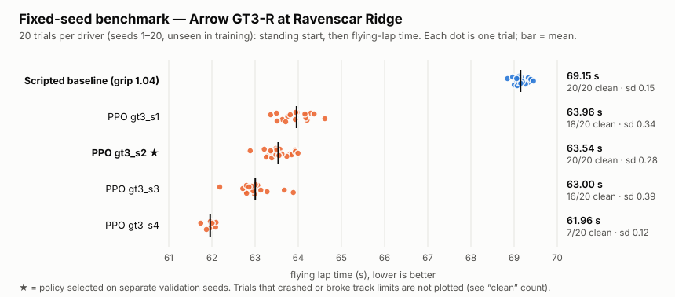

# Racing Simulator

A browser racing simulator with a deterministic vehicle-dynamics core, nine
cars from different classes (GT3, Ferrari 458, Le Mans hypercar, Audi R18 LMP1, stock Mini
Cooper S, hot hatch, muscle coupe, V10 single-seater, electric saloon), six
circuits (one original; Silverstone, Spa, Monza, the Nürburgring Nordschleife
and Monaco from real survey / map data), engine audio played from real
recordings, an interactive telemetry overlay, AI drivers that follow a computed
racing line and trail-brake — and an AI driver trained with reinforcement
learning on the same physics code the browser runs.

```bash
npm install
npm run dev        # http://127.0.0.1:5173
npm test           # physics, determinism, car envelopes, tracks, audio, wet-track model
npm run validate   # measure every car against real-world figures
npm run train -- --car gt3 --seed 1 --steps 3000000
npm run benchmark  # fixed-seed RL vs baseline, writes docs/benchmark-gt3.json
npm run plot       # docs/learning-curve-gt3.svg, docs/benchmark-gt3.svg
```

Controls: **WASD / arrows** drive (gamepad supported) · **Q / E** shift ·
**M** auto/manual · **R** recover · **Enter** restart · **C** camera ·
**T** telemetry · **G** ghost (best / AI) · **I** AI autopilot · **Z** ABS ·
**X** TC · **H** driving difficulty · **L** racing-line guide · **V** weather · **F** perf stats · **N** mute ·
**1–9** car · **Esc** menu.

**Driving difficulty** (menu or **H**; affects only the human driver, never the AI, tests or RL):
*Simulation* is the car as specified. *Assisted* adds ABS, traction and stability control to
every car and 8 % grip. *Easy* is deliberately unrealistic and meant for keyboards: 30 % more
grip, the car steers itself along the racing line when no steering key is held (a held key adds
to it), and it brakes for corners by itself. Measured: with the throttle simply held down and
no other input, Easy laps Ravenscar, Silverstone, Spa, Monza and Monaco cleanly in the GT3,
Mini, formula car and hypercar, and completes a Nordschleife lap in three of the four (the
Mini ran out of test time).

## Architecture

```
src/sim/      deterministic core, no DOM — shared by browser, tests and RL
  track.js      circuits -> typed arrays (centreline, width, curvature, elevation, walls)
  vehicle.js    vehicle dynamics (300 Hz fixed step)
  cars.js       nine car specifications + real-world reference envelopes
  racing-line.js minimum-curvature racing line for any circuit
  sim.js        car + track + lap/sector timing + track limits
  drivers/      line-following driver, RL observation/action interface, policy runner
src/game/     Three.js renderer, cameras, HUD, telemetry, effects, cannon-es props
src/audio/    AudioWorklet engine: recorded engine cycles + synthesised tyres, wind, turbo
rl/           environment, PPO, training, benchmark, plots
tools/        car validation, lap/line tools, audio and car-model build pipelines, screenshots
tests/        node:test suites
```

**Physics library choice.** Three.js renders; cannon-es simulates the loose
trackside objects (cones, braking boards) that the car knocks around. The car
itself is *not* a rigid-body-engine vehicle: generic raycast vehicles don't
give believable tyre behaviour and aren't bit-reproducible, and the RL work
needs both. The vehicle model is purpose-written and runs identically in Node
and the browser (same seed + same inputs = identical state, tested).

### Vehicle model
3-DOF planar chassis plus four wheel-spin states at 300 Hz:

- **Tyres** — combined-slip Magic Formula on a normalised slip vector, load
  sensitivity of peak grip, cornering stiffness that grows sub-linearly with
  load, surface-dependent grip (asphalt / kerb / grass / gravel), and a thermal
  state that costs grip when cold or overheated.
- **Load transfer** — lagged longitudinal and lateral transfer with a per-car
  roll-stiffness split, plus speed-squared downforce with an aero balance.
- **Drivetrain** — engine torque curves, turbo spool, rev limiter, clutch slip
  on launch, gear ratios with shift torque-cut, limited-slip differential,
  FWD / RWD / AWD, lift-off regen on the EV.
- **Aids** — ABS with rear-axle EBD and a model-based traction-control torque
  limiter, only on cars whose real counterparts have them (toggle with Z / X).
- **Environment** — road gradient, track limits, walls.

Not modelled: suspension geometry/kinematics, vertical dynamics over crests,
tyre wear, fuel load, car-to-car contact.

### Cars — measured, not asserted
`npm run validate` runs each car through standard tests on a flat pad and
checks the result against a published range for that class of car:

| car | hp | kg | 0-100 s | 100-0 m | lat g (R60) | top km/h |
|---|---|---|---|---|---|---|
| Arrow GT3-R | 531 | 1320 | 2.93 [2.9,3.6] ok | 24.2 [22,29] ok | 1.54 [1.45,1.75] ok | 283 [270,295] ok |
| Ferrari 458 Italia | 562 | 1565 | 3.40 [3.2,3.7] ok | 31.8 [30,35] ok | 1.07 [1,1.15] ok | 335 [315,335] ok |
| Aurelia LMH | 671 | 1110 | 2.53 [2.4,3.1] ok | 22.0 [17,23] ok | 2.01 [1.9,2.8] ok | 329 [325,350] ok |
| Audi R18 e-tron quattro | 503 | 1000 | 2.72 [2.6,3.4] ok | 21.7 [17,23] ok | 1.97 [1.9,2.8] ok | 318 [315,340] ok |
| Mini Cooper S | 189 | 1310 | 7.22 [6.4,7.3] ok | 35.9 [33,38] ok | 0.90 [0.88,1.02] ok | 237 [225,240] ok |
| Vanta RS | 315 | 1455 | 5.50 [5,6] ok | 31.8 [31,37] ok | 1.09 [0.98,1.12] ok | 273 [262,282] ok |
| Brawler GT 5.0 | 480 | 1795 | 4.70 [4.2,5] ok | 32.5 [31.5,37] ok | 0.98 [0.93,1.05] ok | 300 [270,300] ok |
| FX-10 | 883 | 655 | 2.34 [2.2,2.9] ok | 20.6 [15,21] ok | 2.35 [2.3,3.2] ok | 333 [320,350] ok |
| Volt-R Quad | 766 | 2330 | 3.14 [2.6,3.2] ok | 32.0 [31,37] ok | 1.07 [0.95,1.1] ok | 269 [250,270] ok |

Format: measured `[reference range]`. The muscle coupe's top speed is unrestricted (the real car is limited to 250 km/h).

The Aurelia LMH is a 499P-class Le Mans Hypercar (twin-turbo V6, ~680 hp,
1110 kg, high downforce, no ABS); the Mini is a stock F56 Cooper S (2.0 turbo, FWD,
road tyres). The Audi R18 e-tron quattro is the 2012 LMP1 (3.7 V6 turbodiesel,
~500 hp, rear-drive only here: its front hybrid axle is not modelled). Flying-lap times of the in-game AI (racing-line driver, shipped
tuning, all laps inside track limits; `node tools/ai-laps.js`):

| car | Ravenscar | Silverstone | Spa | Monza | Nordschleife | Monaco |
|---|---|---|---|---|---|---|
| FX-10 | 0:53.54 | 1:58.42 | 2:08.93 | 1:37.46 | 5:49.00 | 1:34.11 |
| Aurelia LMH | 0:56.23 | 2:02.39 | 2:15.14 | 1:43.94 | 6:31.97 | 1:40.37 |
| Audi R18 | 0:57.86 | 2:06.55 | 2:19.84 | 1:48.09 | 6:45.41 | 1:42.55 |
| Arrow GT3-R | 1:04.49 | 2:19.78 | 2:34.87 | 1:57.27 | 7:27.74 | 1:46.91 |
| Ferrari 458 | 1:15.95 | 2:43.20 | 2:59.27 | 2:11.55 | 8:47.63 | 2:03.42 |
| Volt-R | 1:19.09 | 2:49.34 | 3:05.59 | 2:14.41 | 8:44.79 | 2:01.37 |
| Vanta RS | 1:20.83 | 2:52.82 | 3:12.09 | 2:23.72 | 9:30.78 | 2:11.01 |
| Brawler GT | 1:21.50 | 2:54.68 | 3:12.90 | 2:22.70 | 9:34.15 | 2:11.70 |
| Mini Cooper S | 1:28.97 | 3:07.44 | 3:29.80 | 2:38.57 | 10:28.72 | 2:23.31 |

The class order is what it should be everywhere. Absolute pace on the real
circuits is 10-15 % off real-world lap records for the class (e.g. GT3 at Spa:
2:34.9 here, about 2:17 in reality): the driver keeps a safety margin and the
model has no suspension, so kerb-riding and crest behaviour are missing.

### Circuits
| Circuit | Length | Layout source | Elevation |
|---|---|---|---|
| Ravenscar Ridge | 2.91 km | Original design: 10 turns, hairpin, esses, flat-out kink | designed, 23 m relief |
| Silverstone GP | 5.89 km | Surveyed centreline + widths (TUMFTM racetrack-database, LGPL-3.0) | hand-approximated (nearly flat) |
| Spa-Francorchamps | 7.00 km | same | EU-DEM 25 m terrain model, 106 m relief |
| Monza | 5.79 km | same | EU-DEM 25 m |
| Nürburgring Nordschleife | 20.75 km | OpenStreetMap centreline (ODbL) | EU-DEM 25 m, 288 m relief |
| Monaco | 3.31 km | OpenStreetMap street centrelines (ODbL), official 3.337 km | SRTM 30 m, ~53 m relief, noisy between buildings so gradient is capped at 11 % |

What "real" means here, precisely: the **plan-view layout is real survey or
map data** (lap lengths within 1 % of official figures — tested), and elevation
on four of the five real circuits is sampled from public terrain models and
smoothed. Track width is surveyed for the TUMFTM circuits and estimated for
the Nordschleife and Monaco. **Kerbs, run-off, barriers, buildings and scenery
are generated**, themed per circuit (forest and close armco at the
Nordschleife, barriers at the kerb and apartment blocks at Monaco) but not
replicas of the real venues: no Monaco tunnel or harbour, no Eau Rouge
grandstands. Laser-scan-grade recreations need licensed scan data.

### AI racing line
`src/sim/racing-line.js` computes a minimum-curvature line inside the track
limits for every circuit (projected Gauss-Seidel, coarse to fine). The AI
driver follows it with pure pursuit and a curvature-limited speed profile, and
**trail-brakes**: brake pressure is released as lateral load builds, by a
per-car fraction. Measured with `tools/trail.js` on Ravenscar in the GT3: the
line driver spends 42 % of its braking time above 70 % of cornering grip
(centre-line driver 8 %, RL policy 60 %). Press **L** in the game to draw the
line on the road, coloured by throttle (green), coast (amber) and brake (red).

### Rendering
Three.js r187 with image-based lighting from a photographed HDR sky (Poly
Haven), scanned PBR asphalt, grass, gravel and concrete (Poly Haven,
ambientCG), rubbered-in racing line, AgX tone mapping, GTAO, bloom and SMAA on
high quality. Seven of the nine cars use detailed third-party glTF models
(Draco-compressed, wheels cut out and re-rigged offline by
`tools/models-build.mjs`); every asset, author and licence is listed in
[ASSETS.md](ASSETS.md).

### Weather and time of day
Six conditions, chosen in the menu, with **V** while driving, or by URL
(`?wx=clear|golden|overcast|rain|storm|dusk`, alongside `?track=`, `?car=`,
`?q=`): clear day (the photographed sky), golden hour, overcast with a damp
track, rain, a storm at low sun, and dusk with lights on. They switch in place.

- **One description drives everything** (`src/game/wx.js`): the sky, the sun
  light, the environment map, the fog and its glow toward the sun are all
  built from the same numbers, so they cannot disagree. Skies other than the
  clear day are generated (`src/game/skygen.js`): fbm cloud decks with
  self-shadowing and a sun gap, baked once per condition into an HDR panorama
  that is also prefiltered (PMREM) for image-based lighting. Low suns sit ahead
  of the grid on every circuit.
- **Wet surfaces** (`src/game/world.js`): asphalt darkens and turns glossy
  under a water film, standing water gathers along the edges and in low spots
  with rain rings, the rubbered line dries first on the damp track; kerbs,
  paint, grass, gravel, paving and barriers respond too. The car and its lamps
  are mirrored in the road (a second, car-only render from the reflected
  camera; medium and high quality).
- **Rain, spray, light** (`src/game/weather.js`): streaks drawn along each
  drop's motion relative to the camera, so they slant and stretch with speed;
  wheel spray that grows with speed; screen-space light shafts from the open
  sky, water beads on the lens, lightning that relights the scene (thunder
  follows after the distance delay); headlights, brake and rain-light glows,
  and floodlights along the start straight at dusk.
- **Physics** (`src/sim/wet.js`): a wet state scales tyre grip — rain 0.77 and
  storm 0.72 of dry on asphalt, less in the standing water at the edges (up to
  -14 % / -20 %), on painted kerbs and on grass; the damp track is 0.88 off
  line but nearly dry on it. `null` (the default) leaves the simulation
  bit-identical, which the tests check. The racing-line driver scales its
  speed profile and feeds the power in more gently (`tools/wet-laps.js`
  measures it): GT3 at Spa 2:34.87 dry, 3:02.65 rain, 3:09.45 storm.
- **Quality tiers**: low draws a quarter of the rain, no mirror and no lens
  pass; medium adds a short post chain only when the weather needs it; high
  keeps its full chain.

### Audio
Every combustion car's engine is **played from a real recording** of that
engine type (Wikimedia Commons, CC BY / CC BY-SA; sources and authors in
[AUDIO.md](AUDIO.md)). The recordings are rev blips and pull-aways rather than
steady loops, so `tools/audio-build.py` tracks the firing frequency, cuts each
recording into single 720° engine cycles, sorts them by rpm and by on/off
load, and the AudioWorklet replays cycles at the simulated crank phase: pitch
follows rpm exactly, and a different real cycle each revolution keeps the
natural roughness.

| Car | Recording used | Bands with real cycles (rpm) |
|---|---|---|
| Arrow GT3-R | Porsche 911 GT3 (991), flat-six | 1300–9200, all |
| Ferrari 458 | 458 Speciale + 458 Italia | 740, 1840–9100 |
| Brawler GT | Ford Mustang GT 5.0 + Mach 1 | 925–4000, 6080, 7500 |
| Vanta RS | Honda Civic Type R | 1300, 2460–7100 |
| Mini Cooper S | Mini Countryman / Clubman (same 2.0 turbo family) | 800–6600, all |
| Aurelia LMH | Ferrari 296 (120° twin-turbo V6) + Nissan GT-R | 3030–4290 and 6075 only; rest pitch-shifted |
| FX-10 | F1 V10s (Red Bull RB1 2005, STR1 2006) + Porsche Carrera GT below ~9000 | 14,300 and 16,500; 4000 and 4600 |
| Volt-R | none found — synthesised motor and inverter whine | — |
| Audi R18 | none found (no open turbodiesel race recording) — synthesised | — |

Measured against the source recordings at matched rpm (log-spectral distance,
1/6-octave bands): the previous pure synthesiser was 11–16 dB away and almost
perfectly periodic; the recorded-cycle engine is 2.6–6.4 dB away with
real cycle-to-cycle variation, and about 8 dB from *different* cars of the same
engine type (roughly the car-to-car spread). Turbo whistle and blow-off, gear
whine, overrun pops, tyre squeal and scrub, wind, kerbs, grass and gravel are
synthesised layers; exterior, bonnet and trackside (Doppler) cameras have
separate mixes. **Nobody has listened to this**: this environment has no audio
output, so everything was tuned by spectra and level meters. AUDIO.md lists
what to listen for first and the known weak spots.

## Reinforcement learning

The AI driver is trained with PPO on the **same** `src/sim` code the game runs.

- **Environment** (`rl/env.js`): 20 Hz decisions over 300 Hz physics. 24 observations (speeds, yaw rate, lateral offset, heading error, steering, g-forces, rear slip, gradient, front/rear tyre temperature, curvature at 10 look-ahead distances up to 200 m). Two actions: steering (through the same speed-sensitive steering map the keyboard uses) and a combined throttle/brake pedal. Reward = metres of progress; leaving the circuit ends the episode with a speed-scaled penalty. Starts are randomised around the lap (12 % from the grid), with ±4 % track grip and tyre temperatures anywhere from cool to badly overheated — all drawn from the episode seed.
- **Learner** (`rl/ppo.js`): dependency-free PPO-clip, 64×64 tanh MLPs, GAE(0.95), γ = 0.992, 32 envs × 128 steps, 5 epochs, KL-adaptive learning rate. The policy is mirror-equivariant by construction (a left-hander and its mirror image share weights) and its action means are tanh-bounded.
- **Determinism**: a (car, seed, steps) triple fully determines training; evaluation is bit-reproducible (re-running the champion on the benchmark seeds gave identical lap times: **true**). The same policy produces the same lap in Node and in Chromium.
- **Protocol**: every trial is a standing start plus a 6-lap stint. *Flying lap* = lap 2, counted only inside track limits. *Stint* = all 6 laps clean, scored on the mean of laps 2–6. Checkpoints are kept during training on 4 validation seeds (8-lap stints); the champion is chosen among runs on 20 further validation seeds (clean stints first, then pace). The benchmark uses 20 different seeds (1–20). The baseline gets its best shot: its grip factor is swept and the fastest setting with every stint clean is used (grip 1.04).

**Result — Ravenscar Ridge, Arrow GT3-R, 20 fixed-seed trials each:**

| Driver | Clean stints | Stint pace (s/lap) | Clean flying laps | Flying lap mean (s) | Best | Hottest tyre | Validation (20 seeds) |
|---|---|---|---|---|---|---|---|
| Scripted baseline (grip 1.04) | 20/20 | 69.19 | 20/20 | 69.15 | 68.85 | 105 °C | — |
| PPO gt3_s1 | 20/20 | 63.72 | 20/20 | 63.66 | 63.12 | 112 °C | 20/20, 63.71 s |
| PPO gt3_s2 ★ | 20/20 | 62.98 | 20/20 | 62.94 | 62.28 | 115 °C | 20/20, 62.95 s |
| PPO gt3_s3 | 6/20 | 62.99 | 16/20 | 62.93 | 62.61 | 114 °C | 11/20, 63.02 s |
| PPO gt3_s4 | 20/20 | 63.96 | 20/20 | 63.81 | 63.44 | 109 °C | 20/20, 63.95 s |

★ = champion chosen by validation. Over a 6-lap stint it averages **62.98 s** per lap against the baseline's **69.19 s** — **9.0 % faster** — with 20 of 20 stints fully clean (baseline 20/20).




Why it is faster: the baseline follows the centre line and brakes in a straight line; the racing-line driver added later (64.96 s/lap, 20/20 clean on the same seeds) closes two thirds of the gap, and the policy is still 3 % quicker than that. It learned to use the full width, trail-brake and carry more apex speed. In the game, press **I** to let it drive, **G** to race its ghost, or pick "AI lap" in the telemetry panel to overlay its traces on yours.

Two things that did not work first (details in the changelog): (1) the initial runs never completed a lap — agents flew off at the one significant right-hander until the policy was made mirror-symmetric; (2) the first successful policies set 62–64 s flying laps but **crashed on lap 3 of every stint** with tyres at 120–160 °C, because 60-second training episodes never showed them overheated tyres. Tyre temperature was added to the observations and to the start-state randomisation, and selection moved from one hot lap to multi-lap stints.

## Measured performance

Measured in this repository's CI-like container (4 vCPU, **no GPU**: Chromium renders with SwiftShader software rasterisation, so frame rates are a pessimistic floor, not what a GPU will do).

| Metric | Value |
|---|---|
| Physics throughput (headless Node, 1 core) | 1,225,743 steps/s = 4086× real time |
| Physics cost per 60 Hz frame (5 steps) | 0.004 ms |
| RL training throughput | 1930 env steps/s per process (4 in parallel) |
| Training time | 23.8 min per 3M-step seed |
| Build size | 2043 kB JS (552 kB gzip) + 5.6 MB car models, 3.5 MB engine recordings, sky and textures |
| Render, software GL, 1280×720 | 11–39 fps across low/medium at Ravenscar and Spa (215–321 draw calls, 110k–563k triangles) |
| Test suite | pass 24 fail 0 |

The software-rendered frame rates are noisy (the same scene measured between 11
and 39 fps in consecutive runs) and say little beyond "it runs"; texture-heavy
PBR shading is exactly what a CPU rasteriser is worst at. Performance on a real
GPU has not been measured.

## Known limitations
- **Visuals** are roughly a decade behind a current commercial sim, not at
  Assetto Corsa Competizione level. Lighting, surfaces and seven car models
  are photographic or authored assets; trackside scenery is generated, trees
  are photo cards, and no venue is a replica.
- **Car models do not all match the car simulated.** Only openly licensed
  models whose authorship looked genuine were used: the GT3 is a road 911
  (no wing or race livery), the 499P-class hypercar and the Mini have
  code-generated bodies (visibly simpler than the rest), the muscle coupe is a 1967 fastback, the formula car and R18
  carry their authors' liveries with real sponsor logos. See ASSETS.md.
- **Audio** has never been heard by its developers (see above); the hypercar
  and formula banks are thin and rely on pitch-shifting, and the recordings are
  road cars free-revving, not race cars on load.
- **Circuits**: real layouts and (mostly) real elevation, generated
  surroundings. Monaco has no tunnel or harbour; Silverstone's elevation is
  approximated; width at the Nordschleife and Monaco is estimated.
- **AI pace** on the real circuits is 10–15 % off real lap records.
- The RL policy is trained for one car (GT3) on one circuit (Ravenscar); every
  other combination uses the racing-line driver.
- **Weather** is a fixed state per session, not a forecast: no transitions,
  no drying or rubbering-in over a stint, no aquaplaning model and no wet
  tyres (cars stay on their dry compound, slicks included). Wet-road
  reflections show the sky and the car only, not trackside objects. The RL
  policy was trained dry; in the wet the racing-line driver takes over.
- No suspension or vertical dynamics, tyre wear, fuel load or damage; single
  car on track (ghosts don't collide).
- Frame rates below were measured with software rendering; real-GPU
  performance is unmeasured.

## Credits
- Circuit geometry: [TUMFTM racetrack-database](https://github.com/TUMFTM/racetrack-database)
  (LGPL-3.0); Nordschleife and Monaco © OpenStreetMap contributors (ODbL).
- Elevation: EU-DEM (Copernicus) and SRTM (NASA) via opentopodata.org.
- Sky, lighting and surface scans: Poly Haven and ambientCG (CC0).
- Car models (CC BY / CC BY-SA) and engine recordings (Wikimedia Commons,
  CC BY / CC BY-SA): full per-file credits in [ASSETS.md](ASSETS.md) and
  [AUDIO.md](AUDIO.md). The 911 model and the 458, hypercar and formula audio
  banks derive from ShareAlike works and are redistributed under the same terms.
- Rendering: three.js. Prop physics: cannon-es.

Fictional car names are used except for the Ferrari 458 and Mini Cooper S.
This is a non-commercial technical project, not affiliated with or endorsed
by any car maker, sponsor or circuit owner whose name or logo appears.
